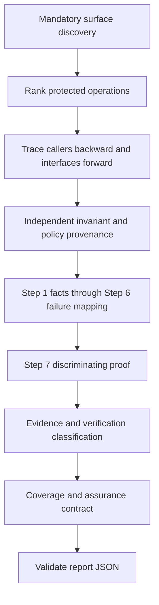

# Forensic Code Auditor architecture

## Standalone package

`forensic-code-auditor` is an independent APM package with no package or MCP dependencies.
Crow, Raven and other scanners may be installed separately as development tools or audited as targets.
Their presence does not change this architecture or confer authority on their scan results.
Local checkouts live in ignored `repos/`; local reports and private findings live in ignored `temp/`.

The canonical distribution root is `.apm/skills/forensic-code-auditor/`. `apm.yml` includes only that
skill. APM deploys authored source to harness-specific locations; installed copies are outputs.

## Analytical flow

The original Step 0 plus seven-step method is preserved: observed facts; hard boundaries;
competing reconstructions; degradation; trust dynamics; failure mapping; discriminating proof.
Discovery precedes conditional specialist routing so the auditor need not recognize a defect before
loading the procedure that could discover it.

## Responsibility boundaries

| Component | Responsibility |
|---|---|
| `SKILL.md` | Trigger, discovery gate, progressive disclosure and concise workflow |
| `instructions.md` | Canonical doctrine, evidence/assurance meanings and operation completion |
| `agents/forensic_systems_analyst.md` | Analyst role and operation-centric execution discipline |
| `references/` | Authorization-data reconstruction, cross-entrypoint tracing, infrastructure trust, taxonomy and specialist prompts |
| `templates/` | Report schema, operation coverage, permission matrix and assurance skeleton |
| `scripts/` | Report validation, local demo and reproducible scanner testing |
| `tests/` | Vulnerable/protected synthetic models and negative report-contract cases |
| `evals/` | Preserved routing and behavior tasks; these are not automatically executed LLM evaluations |

## Authorization reconstruction

For each selected sink, trace Forms/menu, triggers, procedures, direct grants, APIs, jobs, queues,
schedulers and tools. Record originating, authenticated, delegated and DB connection identities,
session/tenant state, policy source/version, actual checks and durable effects. List unavailable edges.

For data-driven access, reconstruct navigation hierarchy and effective grants with the actual evaluator's
precedence, inheritance, exceptions, wildcard/NULL, scope and effective dates. Compare independently
intended policy with configuration and runtime decisions. A correct Level 2 evaluator consuming an
incorrect row is an authorization-data integrity failure. Missing independent policy yields `NON LIQUET`.

Each operation records nine completion items: invariant, entry points, policy provenance, execution
trace, competing defenses, hypothesis, discriminating proof, classification and coverage. Every item
has evidence or explicitly states the missing evidence. Unknown branches remain visible.

## Evidence and assurance

Evidence (`CONFIRMED`, `SUSPECTED`, `NON LIQUET`, `REFUTED`) is independent of verification
(`STATIC_PROVEN`, `DYNAMIC_REPRODUCED`, `TEST_GENERATED`, `NOT_VERIFIED`) and severity.
Assurance (`VERIFIED_SCOPE`, `PARTIAL`, `INSUFFICIENT_EVIDENCE`, `NOT_ASSESSED`) measures coverage.
Schema v2 verifies evidence files/hashes/locators, execution records, required discovery categories and candidate accounting. It retains the v1 validator for legacy structural checks. It rejects unqualified `SECURE`/`PASS`, missing operation items, unexecuted dynamic
proof and unsupported assurance. It validates artifact availability/integrity and declared coverage, not semantic truth or honest initial discovery.

## Detection and test boundaries

The Semgrep catalog contains 30 candidate/inventory rule IDs in 24 rule files with paired positive/negative
fixtures. Inventory hits feed a bounded operation graph; its limitations remain part of coverage. Two CodeQL packs now contain three queries: the original Python tenant and JavaScript FSM
queries plus a Python scope-provenance/raw/bulk inventory query. Original scanner identifiers stay stable.
The revised queries compile and pass five pinned qltests (including extraction counts) with CodeQL 2.23.3.

Synthetic tests demonstrate sequential committed authorization effects, report gates, forced local
revocation timing, tenant context reuse, replay and approval binding. SQLite is used only for local
committed-state assertions; it proves no Oracle/PG lock semantics. Oracle Forms extraction, real DB
concurrency and a matched-model before/after skill comparison remain separate verification tasks.

All reproductions require explicitly authorized disposable local resources and synthetic data.
Rollback alone cannot isolate autonomous commits or external effects. See
[TESTING.md](.apm/skills/forensic-code-auditor/TESTING.md) for commands and limitations.
